# PRD — Portal Web Direktori, Pendaftaran, dan Manajemen Race Pack Event Lari & Marathon Lokal

| | |
|---|---|
| **Judul** | Rancang Bangun Portal Web Direktori, Pendaftaran, dan Manajemen Race Pack Event Lari & Marathon Lokal |
| **Jenis** | Aplikasi web (responsif), satu platform untuk banyak penyelenggara |
| **Versi dokumen** | 1.0 — 24 November 2026 |
| **Prototipe** | https://claude.ai/artifact/VHTQ3LELtHVhsahRn3cDrP (7 halaman, bisa diklik) |
| **Screenshot** | folder `screenshots/` |

---

## 1. Latar belakang & masalah

Event lari lokal (fun run, 10K, half marathon, marathon) terus bertambah, tetapi informasi dan prosesnya tersebar:

1. **Informasi event tercecer** di Instagram, grup WhatsApp, dan formulir online. Pelari sulit membandingkan jadwal, harga, dan kuota.
2. **Pendaftaran manual** lewat Google Form + transfer bank membuat panitia harus mencocokkan bukti bayar satu per satu. Kuota sering terlewati (overbooking).
3. **Pengambilan race pack (RPC) jadi titik paling kacau**: antrean panjang, pencarian nama di spreadsheet cetak, race pack diambil dua kali, ukuran jersey tidak sesuai stok, dan tidak ada catatan siapa yang menyerahkan ke siapa.

Portal ini menyatukan ketiganya: **direktori event → pendaftaran & pembayaran → serah terima race pack berbasis QR**, dengan data yang tersambung dari awal sampai akhir.

## 2. Tujuan & metrik keberhasilan

| Tujuan | Metrik | Target MVP |
|---|---|---|
| Pelari mudah menemukan event | Event bisa difilter kota, bulan, kategori | 100% event terverifikasi tampil di direktori |
| Pendaftaran tanpa verifikasi manual | Status bayar berubah otomatis lewat webhook | 0 konfirmasi manual untuk pembayaran via gateway |
| Kuota tidak pernah terlampaui | Jumlah peserta lunas ≤ kuota kategori | 0 kasus overbooking pada uji konkurensi 50 request |
| RPC lebih cepat | Waktu layanan per peserta di meja RPC | ≤ 30 detik (scan → konfirmasi) |
| Tidak ada pengambilan ganda | QR yang sudah dipakai ditolak | 100% scan ulang ditolak dan tercatat |
| Kebutuhan jersey akurat | Rekap ukuran dari data pendaftaran | Rekap tersedia real-time, selisih stok terlihat |

## 3. Aktor

| Aktor | Deskripsi | Akses utama |
|---|---|---|
| **Pengunjung** | Belum login | Melihat direktori dan detail event |
| **Pelari** | Akun peserta | Daftar, bayar, e-ticket & QR, pengambilan diwakilkan, riwayat |
| **Penyelenggara (EO)** | Komunitas/EO terverifikasi | Kelola event, kategori, kuota, harga, promo, peserta, race pack, laporan |
| **Petugas RPC** | Dibuat oleh EO, terikat ke satu event | Scan QR, konfirmasi serah terima (tampilan HP) |
| **Admin platform** | Pengelola portal | Verifikasi EO & event, master data, statistik |

## 4. Ruang lingkup

### Termasuk MVP
- Direktori event dengan pencarian dan filter
- Akun pelari dan profil tersimpan
- Pendaftaran individu dan kolektif (komunitas)
- Harga bertingkat (early bird / normal) dan kode promo
- Pembayaran lewat payment gateway (Midtrans/Xendit **mode sandbox**)
- E-ticket PDF + QR bertanda tangan, nomor BIB otomatis
- Manajemen race pack: isi per kategori, rekap jersey, slot RPC, scan QR, pengambilan diwakilkan, audit log
- Panel EO dan panel admin
- Notifikasi email

### Di luar lingkup MVP
- Timing chip / RFID dan hasil lomba real-time
- Live tracking peserta
- Aplikasi mobile native (cukup web responsif)
- Refund otomatis (refund dicatat manual oleh EO)
- Marketplace merchandise

## 5. Kebutuhan fungsional

Format: **FR-xx** — kebutuhan · *kriteria penerimaan*.

### 5.1 Direktori event
- **FR-01** Daftar event terverifikasi dalam bentuk kartu (tanggal, nama, kota, penyelenggara, kategori, harga mulai, status, bar kuota).
  *Hanya event berstatus `published` yang tampil.*
- **FR-02** Pencarian teks (nama event/penyelenggara) dan filter kota, bulan, kategori jarak (5K/10K/HM/FM).
  *Filter bisa digabung; jumlah hasil ditampilkan.*
- **FR-03** Label status otomatis: *Segera dibuka, Early bird, Dibuka, Kuota penuh, Ditutup, Selesai*, dihitung dari tanggal dan sisa kuota.
- **FR-04** Halaman detail: deskripsi, peta rute (Leaflet + file GPX), jadwal hari H, isi race pack per kategori, info RPC, FAQ, dan pilihan kategori beserta sisa kuota.

### 5.2 Akun & pendaftaran
- **FR-05** Registrasi/login pelari (email + password, verifikasi email). Profil menyimpan data diri, kontak darurat, golongan darah (opsional), ukuran jersey favorit.
- **FR-06** Formulir pendaftaran per kategori: data diri (terisi otomatis dari profil), ukuran jersey, slot pengambilan RPC, persetujuan waiver.
  *Tidak bisa lanjut tanpa mencentang waiver. Validasi usia minimum kategori.*
- **FR-07** Pendaftaran kolektif: satu pembayar mendaftarkan beberapa peserta; tiap peserta mendapat BIB dan QR sendiri.
- **FR-08** Harga mengikuti periode (early bird/normal); kode promo bisa berupa potongan nominal atau persen dengan batas kuota pemakaian.
- **FR-09** Saat checkout, slot kuota **ditahan** (status `pending`) selama 24 jam. Jika tidak dibayar, pendaftaran `expired` dan kuota kembali.
- **FR-10** Pembayaran lewat payment gateway (VA, QRIS, e-wallet). Status `paid` hanya diubah oleh **webhook** yang tanda tangannya valid.
- **FR-11** Setelah `paid`: BIB dibagikan otomatis (format `<kode kategori>-<urutan>`, mis. `21-0347`), e-ticket PDF dibuat, email dikirim.

### 5.3 Tiket saya
- **FR-12** Halaman e-ticket: data peserta, kategori, BIB, ukuran jersey, slot RPC, QR, tombol unduh PDF dan tambah ke kalender.
- **FR-13** Pelacak status race pack: lunas → disiapkan → siap diambil → sudah diambil (dengan waktu dan meja).
- **FR-14** Pengambilan diwakilkan: pelari mengisi nama perwakilan, sistem membuat surat kuasa PDF terisi otomatis.
- **FR-15** Riwayat semua pendaftaran beserta statusnya (menunggu bayar, lunas, kedaluwarsa, selesai).

### 5.4 Manajemen race pack (inti)
- **FR-16** EO mengatur item race pack per kategori (BIB, jersey, goodie bag, dll.).
- **FR-17** Rekap jersey per ukuran dihitung dari peserta lunas; EO mengisi stok yang disiapkan; sistem menampilkan selisih (kurang/lebih).
- **FR-18** EO membuat slot RPC (tanggal, jam, lokasi, kapasitas). Pelari memilih slot saat mendaftar; slot penuh tidak bisa dipilih.
- **FR-19** Petugas memindai QR lewat kamera HP (web, `getUserMedia`) atau mencari manual dengan BIB/nama.
- **FR-20** Hasil scan ada tiga:
  - **Valid** → tampilkan nama, BIB, kategori, jersey, checklist item;
  - **Sudah diambil** → tampilkan kapan, di meja mana, oleh petugas siapa, diterima siapa; **tombol serah terima tidak muncul**;
  - **Tidak valid** → tanda tangan QR salah atau QR bukan untuk event ini.
- **FR-21** Konfirmasi serah terima mencatat: waktu, petugas, meja, penerima (peserta sendiri/perwakilan + nama), foto surat kuasa & KTP bila diwakilkan.
- **FR-22** Satu QR hanya bisa dikonfirmasi **sekali** (dijamin di database, bukan hanya di UI).
- **FR-23** Mode sinyal lemah: konfirmasi disimpan sementara di perangkat dan disinkronkan saat online; konflik (QR sudah dipakai di meja lain) ditandai untuk ditinjau.
- **FR-24** Dashboard race pack: peserta lunas, sudah/belum diambil, diwakilkan, progres per kategori, kehadiran per slot, log serah terima (filter: semua/diwakilkan).
- **FR-25** Tombol kirim pengingat (email) ke peserta yang belum mengambil race pack.

### 5.5 Panel penyelenggara
- **FR-26** CRUD event, kategori, harga per periode, kuota, promo, slot RPC, akun petugas.
- **FR-27** Daftar peserta dengan pencarian dan ekspor CSV/Excel.
- **FR-28** Laporan pendapatan per kategori dan per metode pembayaran.
- **FR-29** Broadcast pengumuman ke semua peserta atau per kategori.

### 5.6 Panel admin
- **FR-30** Verifikasi pendaftaran EO (dokumen: SK/akta komunitas, NPWP, KTP penanggung jawab): setujui atau minta revisi dengan catatan.
- **FR-31** Persetujuan event sebelum tampil (izin keramaian, file GPX, rencana medis).
- **FR-32** Master data: kota, kategori jarak, ukuran jersey.
- **FR-33** Statistik platform: event aktif, EO terverifikasi, peserta, transaksi.

## 6. Alur status

### Status pendaftaran
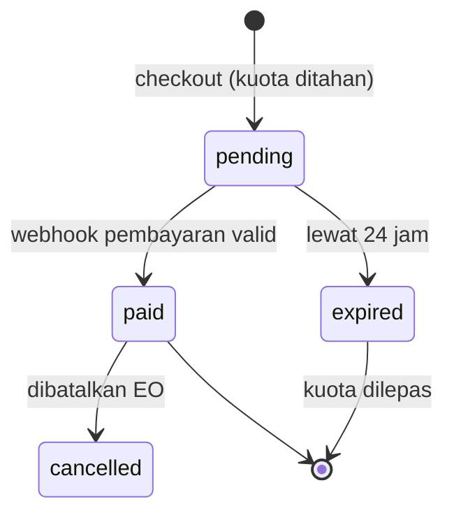

### Status event
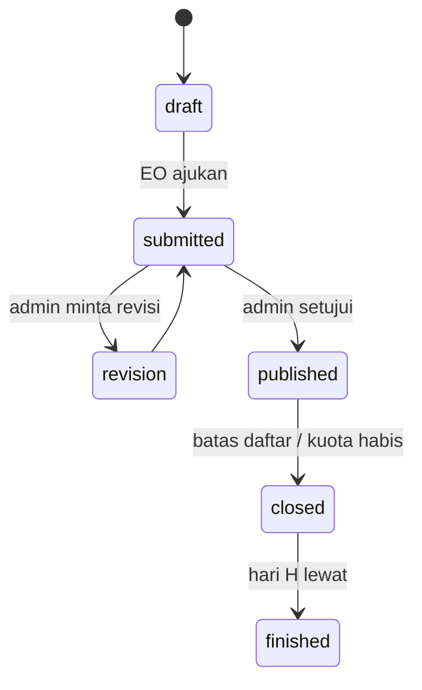

### Alur pengambilan race pack
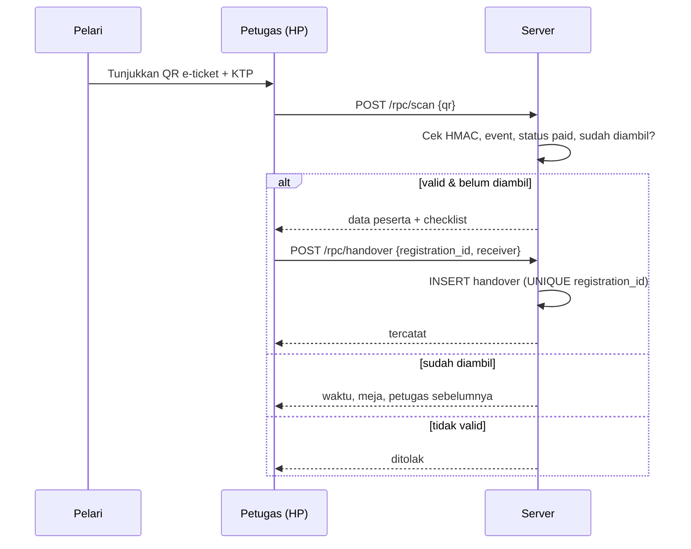

## 7. Aturan bisnis

| ID | Aturan |
|---|---|
| BR-01 | Pengurangan kuota memakai transaksi + `SELECT … FOR UPDATE` pada baris kategori. Hitung `pending + paid ≤ quota`. |
| BR-02 | Pendaftaran `pending` kedaluwarsa setelah 24 jam (job terjadwal tiap 5 menit). |
| BR-03 | Nomor BIB unik per event, dibagikan berurutan per kategori saat `paid`, tidak pernah dipakai ulang. |
| BR-04 | Isi QR: `registration_id.event_id.hmac` dengan `HMAC-SHA256(secret_event, registration_id.event_id)`. QR tidak memuat data pribadi. |
| BR-05 | Satu pendaftaran maksimal satu catatan serah terima (`UNIQUE` di tabel `handovers`). |
| BR-06 | Petugas hanya bisa memindai QR untuk event yang ditugaskan kepadanya. |
| BR-07 | Webhook gateway diverifikasi tanda tangannya dan idempoten (notifikasi berulang tidak mengubah apa pun). |
| BR-08 | Data peserta tidak bisa dipindahtangankan; ganti kategori diperbolehkan sampai batas daftar jika kuota tujuan tersedia. |
| BR-09 | Event hanya tampil di direktori jika EO terverifikasi **dan** event berstatus `published`. |

## 8. Kebutuhan non-fungsional

- **Keamanan**: password di-hash (bcrypt/argon2), otorisasi berbasis peran (policy Laravel), CSRF, rate limit pada login dan endpoint scan, file upload (KTP, surat kuasa) disimpan privat dan hanya bisa diakses EO event terkait.
- **Privasi**: foto KTP dihapus otomatis 30 hari setelah event selesai. Ekspor CSV tidak memuat golongan darah kecuali diminta.
- **Kinerja**: halaman direktori < 2 detik di 4G; katalog publik di-cache (Redis, TTL 5 menit, dihapus saat event diubah); scan → hasil < 1 detik.
- **Konkurensi**: lolos uji 50 checkout bersamaan pada kategori bersisa 10 kuota → tepat 10 berhasil.
- **Responsif**: semua halaman bisa dipakai di layar 360 px; halaman petugas dirancang mobile-first.
- **Aksesibilitas**: kontras teks ≥ 4.5:1, target sentuh ≥ 44 px, semua kontrol bisa dioperasikan dengan keyboard.
- **Audit**: setiap serah terima, perubahan status pendaftaran, dan keputusan admin tercatat (siapa, kapan, apa).

## 9. Model data

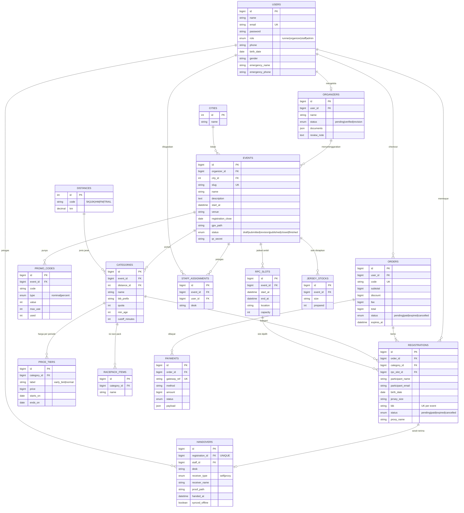

Catatan desain:
- Uang disimpan sebagai **BIGINT rupiah**, bukan desimal.
- `HANDOVERS.registration_id` diberi constraint **UNIQUE** → pengaman terakhir dari pengambilan ganda.
- `REGISTRATIONS` diberi `UNIQUE (event_id, bib)` lewat kolom turunan atau index gabungan dengan `categories.event_id`.
- Index parsial untuk pencarian cepat peserta yang belum mengambil: `WHERE status = 'paid'` pada `registrations`.

## 10. Rancangan API / route utama

| Method | Endpoint | Aktor | Keterangan |
|---|---|---|---|
| GET | `/events` | publik | Direktori + filter `city, month, distance, q` |
| GET | `/events/{slug}` | publik | Detail event, kategori, sisa kuota |
| POST | `/events/{slug}/checkout` | pelari | Buat order + registrasi `pending`, tahan kuota |
| POST | `/payments/webhook` | gateway | Verifikasi tanda tangan, set `paid`, bagikan BIB |
| GET | `/me/tickets` | pelari | Daftar tiket + status race pack |
| GET | `/me/tickets/{id}/pdf` | pelari | Unduh e-ticket |
| POST | `/me/tickets/{id}/proxy` | pelari | Isi perwakilan, buat surat kuasa |
| POST | `/rpc/scan` | petugas | Validasi QR → valid / sudah diambil / tidak valid |
| POST | `/rpc/handover` | petugas | Catat serah terima (idempoten per registrasi) |
| POST | `/rpc/sync` | petugas | Sinkronkan antrean offline |
| GET | `/eo/events/{id}/racepack` | EO | Data dashboard race pack |
| GET | `/eo/events/{id}/participants.csv` | EO | Ekspor peserta |
| POST | `/eo/events/{id}/reminders` | EO | Kirim pengingat ke yang belum ambil |
| PATCH | `/admin/organizers/{id}` | admin | Setujui / minta revisi |
| PATCH | `/admin/events/{id}` | admin | Setujui / minta revisi |

## 11. Prototipe & screenshot

Prototipe interaktif: https://claude.ai/artifact/VHTQ3LELtHVhsahRn3cDrP

| No | Halaman | Screenshot | Kebutuhan |
|---|---|---|---|
| 1 | Direktori event | 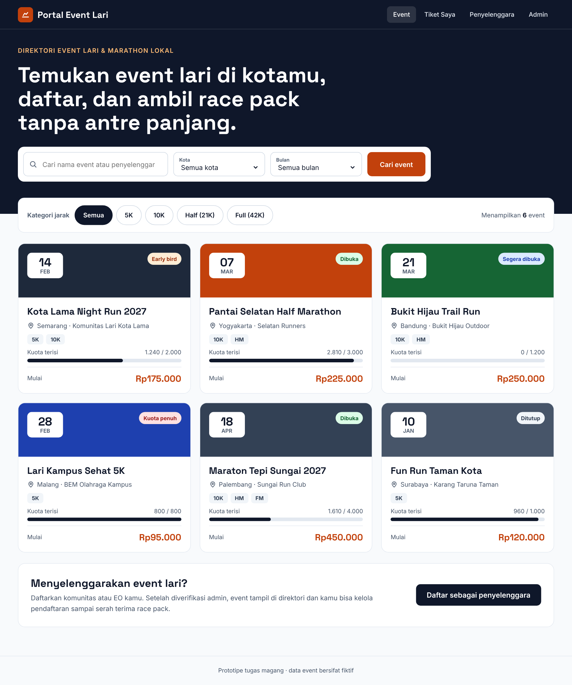 | FR-01 – FR-03 |
| 2 | Detail event | 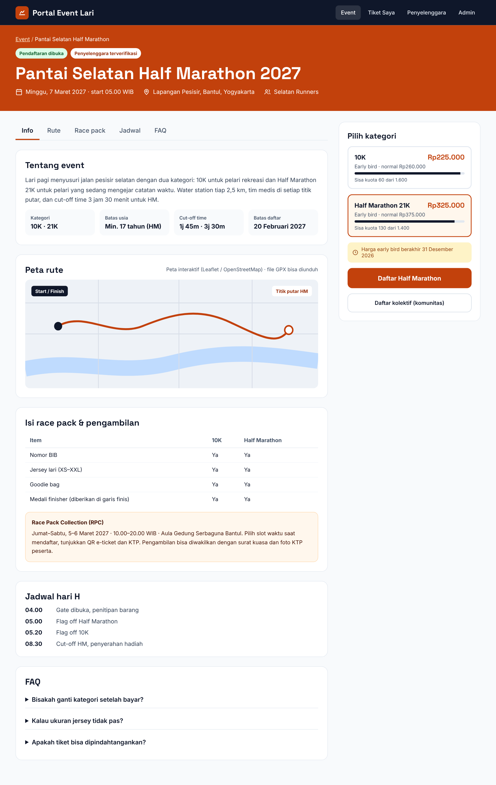 | FR-04 |
| 3a | Pendaftaran — data peserta (kolektif + promo) | 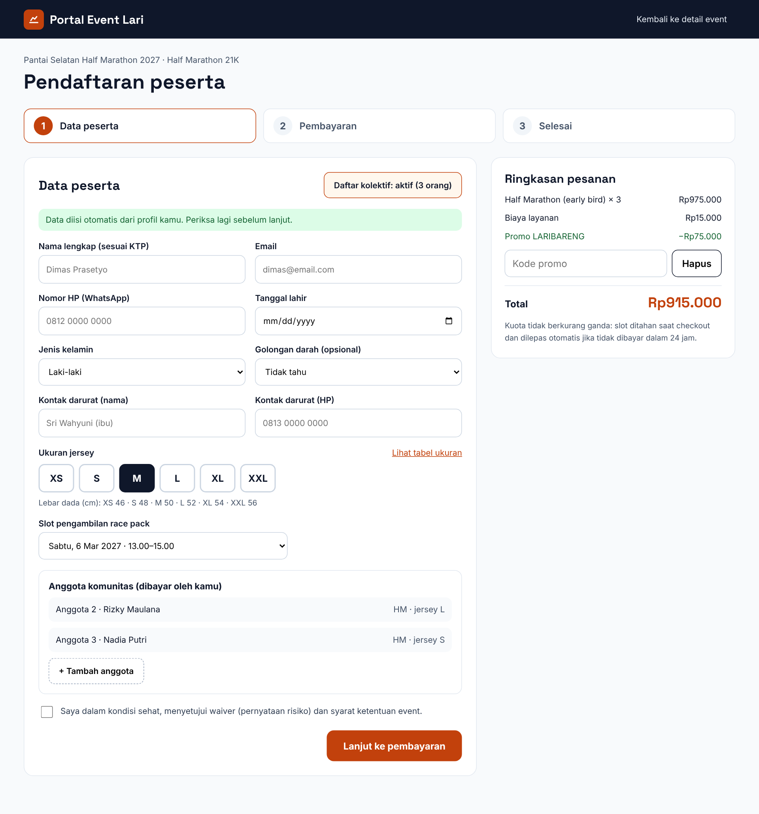 | FR-06 – FR-08 |
| 3b | Pendaftaran — pembayaran | 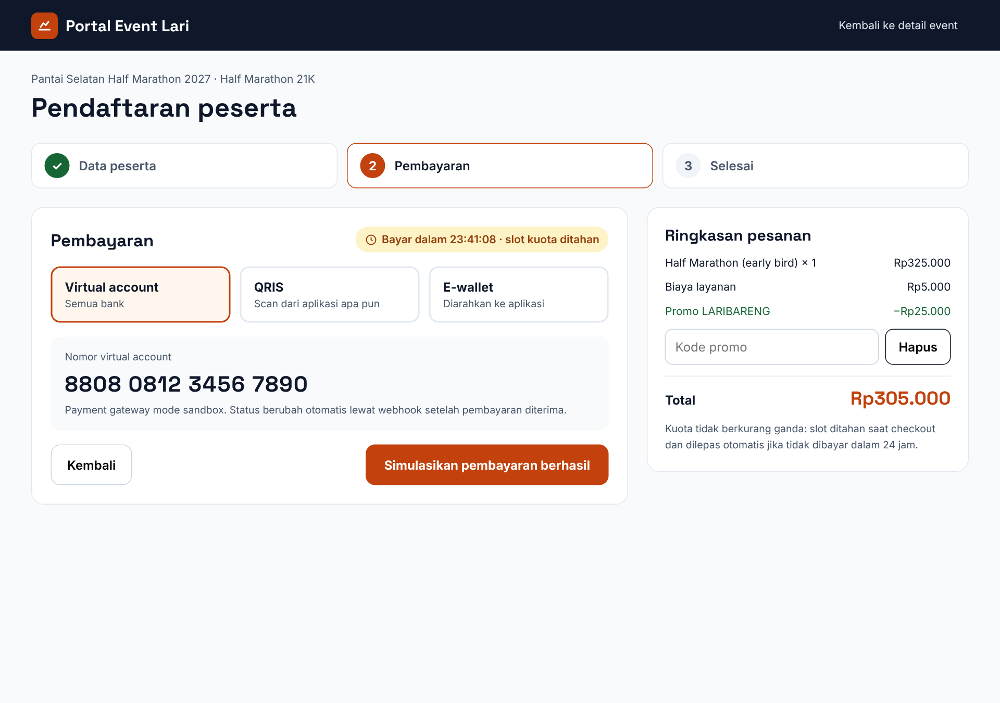 | FR-09, FR-10 |
| 3c | Pendaftaran — selesai | 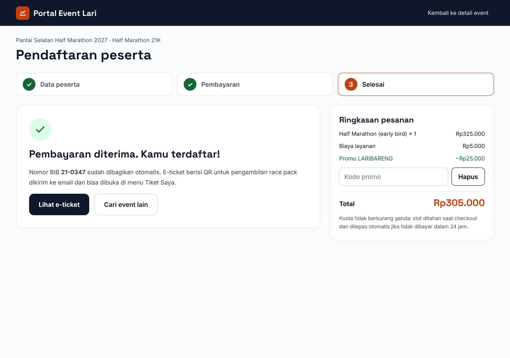 | FR-11 |
| 4 | Tiket saya (e-ticket, QR, diwakilkan) | 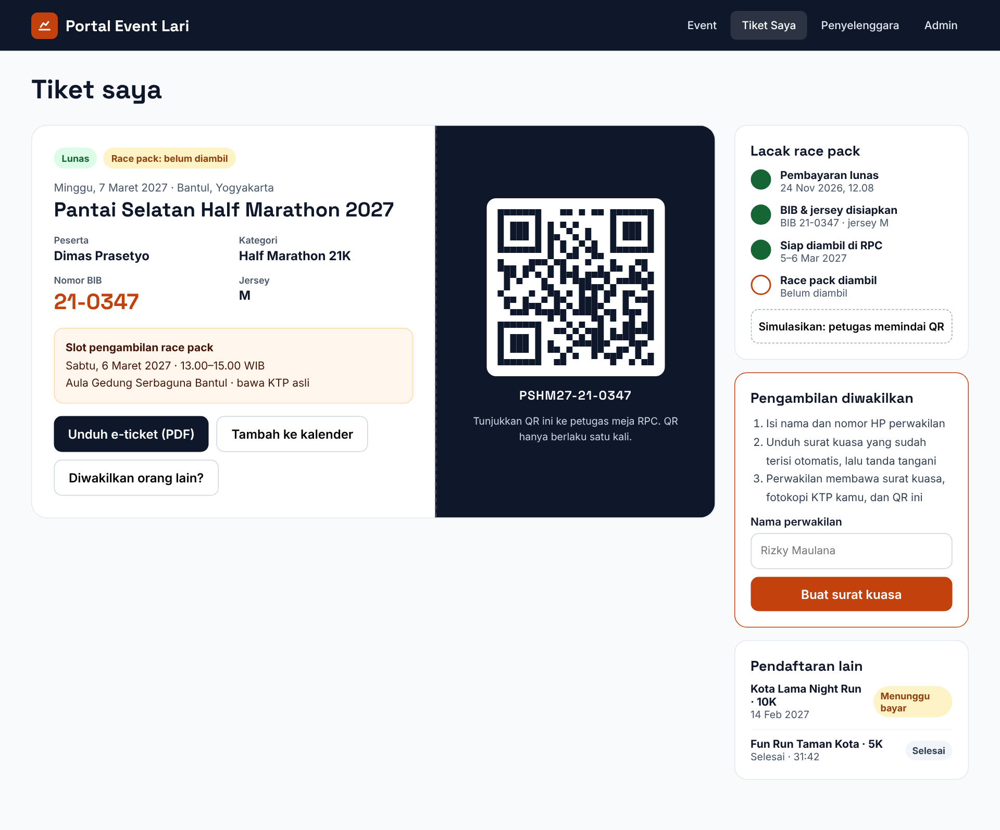 | FR-12 – FR-15 |
| 5a | Petugas — siap scan | 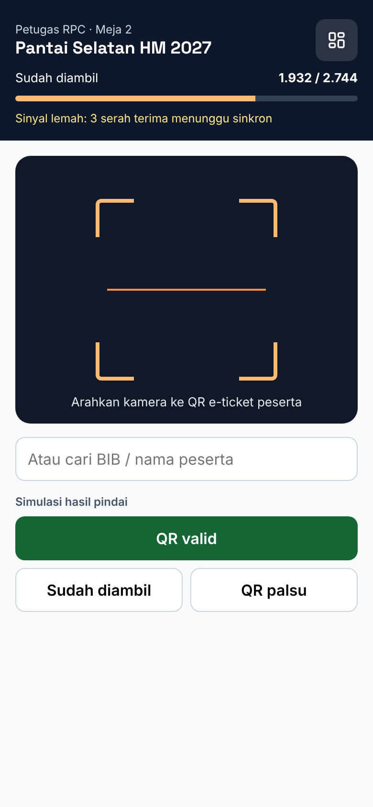 | FR-19 |
| 5b | Petugas — QR valid, diwakilkan | 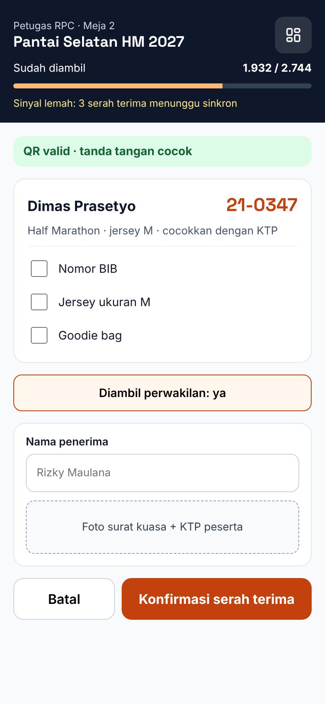 | FR-20, FR-21 |
| 5c | Petugas — sudah diambil | 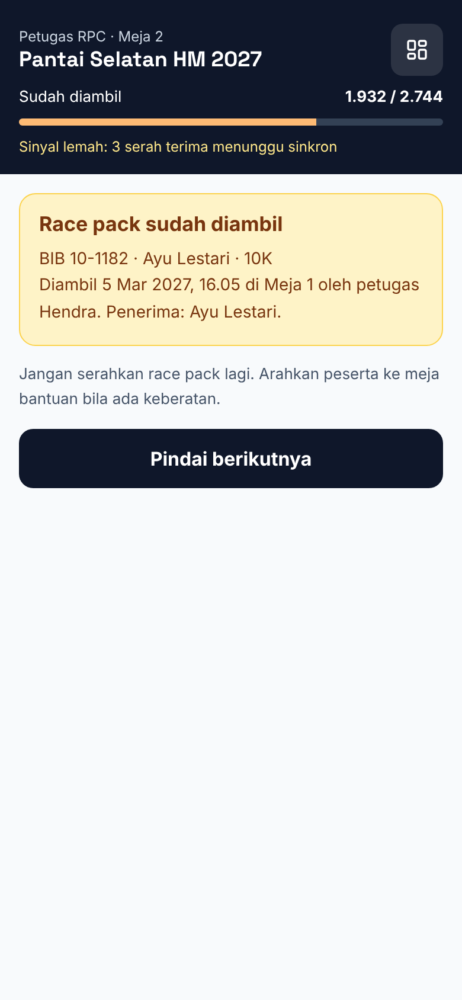 | FR-20, FR-22 |
| 5d | Petugas — QR tidak valid | 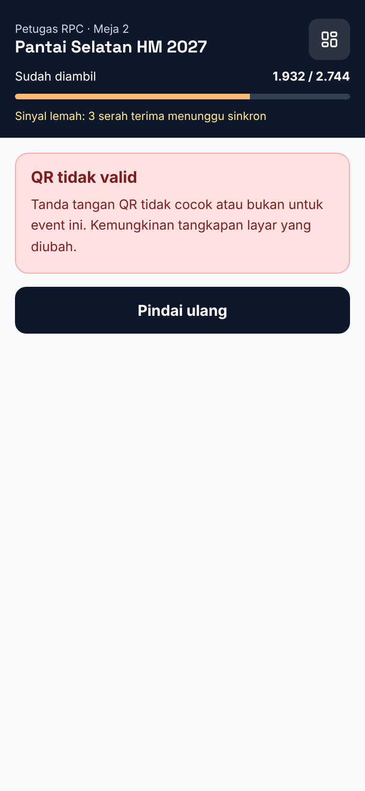 | FR-20 |
| 5e | Petugas — serah terima tercatat | 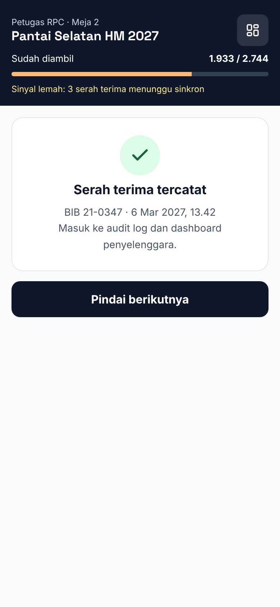 | FR-21 |
| 6 | Dashboard penyelenggara — race pack | 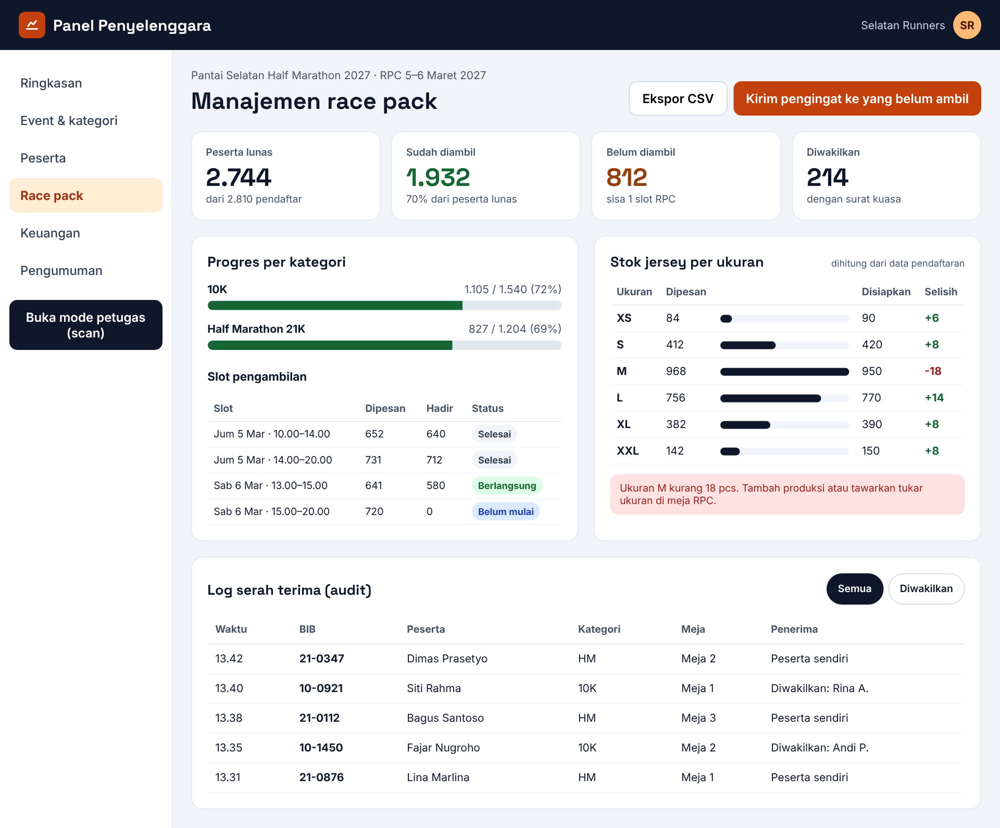 | FR-17, FR-18, FR-24, FR-25 |
| 7 | Admin platform | 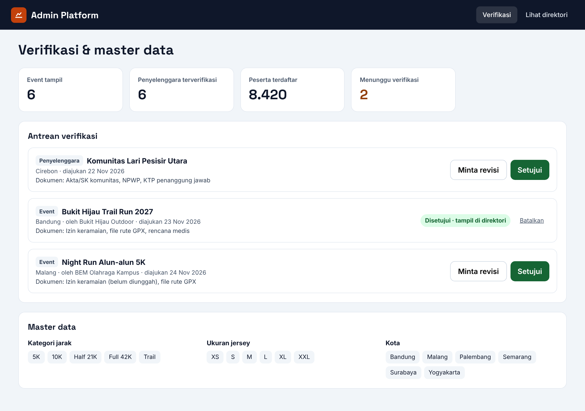 | FR-30 – FR-33 |

Semua data di prototipe fiktif.

## 12. Rencana pengujian (minimal)

| Jenis | Skenario | Hasil yang diharapkan |
|---|---|---|
| Unit | Penentuan harga per tanggal (early bird vs normal) | Harga sesuai periode, promo tidak membuat total negatif |
| Unit | Pembuatan & verifikasi HMAC QR | QR yang diubah 1 karakter ditolak |
| Unit | Label status event | Status sesuai tanggal dan sisa kuota |
| Integrasi | Checkout saat kuota habis | HTTP 409, tidak ada registrasi terbentuk |
| Integrasi | Webhook dikirim dua kali | BIB tetap satu, status tidak berubah dua kali |
| Integrasi | Order `pending` lewat 24 jam | Status `expired`, kuota kembali |
| Integrasi | Scan QR event lain | Ditolak sebagai tidak valid |
| Konkurensi | 50 checkout bersamaan, sisa kuota 10 | Tepat 10 `pending/paid` |
| Konkurensi | Dua petugas konfirmasi QR yang sama bersamaan | Tepat 1 handover tercatat, yang lain mendapat "sudah diambil" |
| E2E | Daftar → bayar (sandbox) → e-ticket → scan → dashboard bertambah | Semua langkah berhasil |

## 13. Asumsi & risiko

- **Asumsi**: penyelenggara memakai akun payment gateway platform (bukan milik EO sendiri) selama tahap MVP; dana disalurkan ke EO di luar sistem.
- **Risiko sinyal di lokasi RPC** → mitigasi dengan antrean offline (FR-23) dan pencarian manual BIB.
- **Risiko QR disalahgunakan (tangkapan layar dibagikan)** → QR sekali pakai + cocokkan KTP + audit log.
- **Risiko data pribadi** (KTP, kontak darurat) → akses dibatasi per event, penghapusan otomatis setelah event.

## 14. Pertanyaan terbuka

1. Apakah refund termasuk alur sistem atau cukup dicatat manual oleh EO?
2. Apakah perlu dukungan banyak payment gateway, atau satu saja untuk tugas ini?
3. Apakah hasil lomba (upload CSV waktu finis) masuk MVP atau fase berikutnya?
4. Siapa yang menanggung biaya layanan: peserta (ditambahkan ke total) atau EO (dipotong dari pendapatan)?
